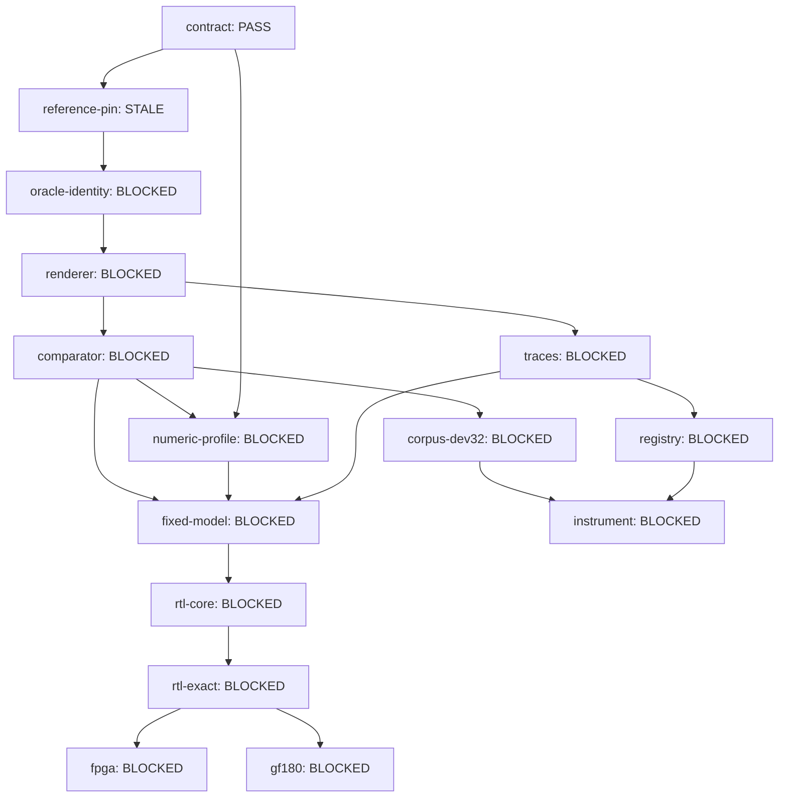

# Capability status (evidence-derived)

<!-- Generated by tools/compile_capabilities.py; edit spec/capabilities-v1.json and evidence/capabilities/, never this view. -->

Claim nodes for the DX7-compatible engine (plan section 7), stamped only by checks registered in `src/gf180_dx7/capabilities.py` (C01, issue #45). File existence, issue closure, tests counts, and prose never turn a node green: PASS requires a registered check that ran clean, content-hash coverage matching the current bytes of every input (including dirty and untracked files), and every required negative control recorded as executed AND detected. Any covered byte change is STALE; missing or undetected controls are NO_VERDICT, never PASS; a required control that reported a guarded skip, or a check-level guarded skip under a `not_run` skip policy, is NOT_RUN, never PASS; unmet prerequisites are BLOCKED.

Regenerate with `python3 tools/compile_capabilities.py`; `--check` verifies these views without executing anything (CI staleness guard); `--strict` additionally requires every node PASS and is the future release gate (honestly red while nodes are NO_VERDICT). Evidence is produced only via `--stamp <node>`, which runs the registered command and the node's required controls, capturing bounded output (sha256 + tail) and unittest run/skip counts into the record. Each node declares a skip policy: `pass` keeps a check-level guarded skip inside PASS (the gap must be named in its exclusions); `not_run` forces NOT_RUN on any reported skip. Whether a registered check can guard-skip at all — and the exact output token that marks it — is declared per check in the `CHECKS` registry (`skip_token`, issue #232): `check_skip_reported` is recorded only for a declared token, so an incidental token in a check that declares no skip path never fabricates a skip.

| Node | Claim | State | Reason |
| --- | --- | --- | --- |
| contract | Frozen v1 product contract: spec/contract-v1.json and docs/DECISIONS-v1.md are in bidirectional lockstep (every DEC id present in both, claim language and omissions guarded) with recorded change control (D00, issue #4). | PASS | registered check ran clean, coverage is current, and every required negative control was recorded as detected |
| reference-pin | The pinned Dexed Mark I reference is exactly at the pinned commit with every pinned file hash and the toolchain matching, and drift is refused (R01, issue #6). Dexed agreement is never original-DX7 fidelity. | STALE | covered bytes changed: spec/capabilities-v1.json, src/gf180_dx7/capabilities.py |
| oracle-identity | The smoke fixture decodes via the P01 codec with the expected non-silent parameter set, and the external oracle binary matches its identity pin; an absent binary is a guarded NOT_RUN, never a pass (R02, issue #7). | BLOCKED | recorded check reported a guarded skip and did not do all of its work (exit_code=0); prerequisite not demonstrated: reference-pin=STALE |
| renderer | The R01-gated harness re-renders the smoke fixture deterministically and the committed dry render cross-checks field-by-field (fixture, rates, counts, hashes, oracle pin) with the exact paired comparator verdict PASS (R02+R04, issues #7 and #11). | BLOCKED | covered bytes changed: spec/capabilities-v1.json, src/gf180_dx7/capabilities.py, tools/compile_capabilities.py; prerequisite not demonstrated: oracle-identity=BLOCKED |
| comparator | The exact paired comparator and its apparatus are qualified: analytic fixtures pass, every known-bad mutation class is caught with the right exit code, and invalid inputs (NaN, length, odd bytes) are never a match (R04, issue #11; committed qualification evidence). | BLOCKED | registered check ran clean, coverage is current, and every required negative control was recorded as detected; prerequisite not demonstrated: renderer=BLOCKED |
| corpus-dev32 | The 32-patch development manifest validates against the archive catalog (identity features, unique canonical hashes, render settings) and the committed render proof pins this manifest and catalog with non-silent sampled renders (R03, issue #10). | BLOCKED | covered bytes changed: spec/capabilities-v1.json, src/gf180_dx7/capabilities.py, tools/compile_capabilities.py, tools/validate_dev32.py; prerequisite not demonstrated: comparator=BLOCKED |
| numeric-profile | Frozen numeric profile: integer formats, rounding, LUT and phase choices fixed in a machine-readable contract with content hashes, re-derived rather than restated: schedule and storage arithmetic recomputed, derived constants re-evaluated from their cited formulas, provisional tables regenerated byte-identically, event timing agreeing with the frozen contract, and every decision carrying an error and cost estimate (N01, plan section 7, DR-0003, issue 15). | BLOCKED | covered bytes changed: reference/manifest.json, spec/capabilities-v1.json, src/gf180_dx7/capabilities.py; prerequisite not demonstrated: comparator=BLOCKED |
| traces | Non-invasive trace capture from the pinned external oracle: traced and untraced renders are byte-identical, the versioned tap registry validates, and the trace gate holds per 64-sample block (R05, issue #12). | BLOCKED | covered bytes changed: spec/capabilities-v1.json, src/gf180_dx7/capabilities.py, tools/compile_capabilities.py; prerequisite not demonstrated: renderer=BLOCKED |
| fixed-model | Frozen integer model reproduces the pinned software reference within declared error budgets, case coverage reported separately from agreement (plan section 7). | BLOCKED | recorded check did not run (exit_code=2); prerequisite not demonstrated: comparator=BLOCKED, numeric-profile=BLOCKED, traces=BLOCKED |
| rtl-core | Per-module RTL is sample-exact with the frozen integer model in simulation (plan section 7). | BLOCKED | registered check ran clean, coverage is current, and every required negative control was recorded as detected; prerequisite not demonstrated: fixed-model=BLOCKED |
| rtl-exact | Integrated RTL is sample-exact (bit-exact) with the frozen integer model end to end at 48 kHz (plan section 7). | BLOCKED | recorded check reported a guarded skip and did not do all of its work (exit_code=0); prerequisite not demonstrated: rtl-core=BLOCKED |
| fpga | FPGA digital captures match the integrated model on the chosen board with alignment/calibration evidence (plan section 7). | BLOCKED | declared check is not registered; the node cannot pass until a check is registered, run, and stamped (engine: planned: FPGA capture check; no registered check may stamp this node yet); prerequisite not demonstrated: rtl-exact=BLOCKED |
| gf180 | gf180mcu synthesis/place-and-route with committed stage evidence from the pinned flow (plan section 7). | BLOCKED | declared check is not registered; the node cannot pass until a check is registered, run, and stamped (engine: planned: gf180 flow stage-evidence check; no registered check may stamp this node yet); prerequisite not demonstrated: rtl-exact=BLOCKED |
| registry | Complete directed compatibility registry over the corpus with per-patch codec/render outcomes (R06, issue #13). | BLOCKED | declared check is not registered; the node cannot pass until a check is registered, run, and stamped (engine: planned: registry qualification check (R06); no registered check may stamp this node yet); prerequisite not demonstrated: traces=BLOCKED |
| instrument | The instrument is musically useful: audition/recall protocol over the curated bank with listening records (plan section 7; E3). | BLOCKED | declared check is not registered; the node cannot pass until a check is registered, run, and stamped (engine: planned: listening-protocol check; no registered check may stamp this node yet); prerequisite not demonstrated: corpus-dev32=BLOCKED, registry=BLOCKED |

## contract — PASS

Frozen v1 product contract: spec/contract-v1.json and docs/DECISIONS-v1.md are in bidirectional lockstep (every DEC id present in both, claim language and omissions guarded) with recorded change control (D00, issue #4).

- Prerequisites: none.
- Check: `contract-tests-v1` — `python3 -m unittest tests.test_contract_v1 -v`.
- Covered inputs (plus the judge's own bytes): `docs/DECISIONS-v1.md`, `spec/contract-v1.json`.
- Required negative controls: none declared.
- Skip policy: `pass` — a check-level guarded skip stays within PASS (named in exclusions).
- Exclusions: No fidelity or hardware claim; contract text is not evidence of behavior; Drift guards (claim-language, omissions, bidirectional DEC ids) are embedded in the registered check itself; any covered-byte change is STALE.
- Evidence: `evidence/capabilities/contract.json`.

## reference-pin — STALE

The pinned Dexed Mark I reference is exactly at the pinned commit with every pinned file hash and the toolchain matching, and drift is refused (R01, issue #6). Dexed agreement is never original-DX7 fidelity.

- Prerequisites: contract.
- Check: `reference-pin-v1` — `python3 tools/verify_reference.py`.
- Covered inputs (plus the judge's own bytes): `reference/manifest.json`, `reference/oracle-identity.json`.
- Required negative controls: `pin-drift-refused` detects one mutated pinned byte and a wrong clone HEAD are both refused by the verifier (`python3 -m unittest tests.test_reference_manifest.TestPinnedTree`).
- Skip policy: `pass` — a check-level guarded skip stays within PASS (named in exclusions).
- Exclusions: No claim that Dexed equals an original DX7; No engine execution or audio claim; this is the pin, not a render; Environment-bound: requires the local clone; CI evaluates recorded evidence only.
- Evidence: `evidence/capabilities/reference-pin.json`.

## oracle-identity — BLOCKED

The smoke fixture decodes via the P01 codec with the expected non-silent parameter set, and the external oracle binary matches its identity pin; an absent binary is a guarded NOT_RUN, never a pass (R02, issue #7).

- Prerequisites: reference-pin.
- Check: `render-selfcheck-v1` — `python3 tools/render_selfcheck.py`.
- Covered inputs (plus the judge's own bytes): `reference/fixtures/smoke/events.txt`, `reference/fixtures/smoke/voice.syx`, `reference/oracle-identity.json`.
- Required negative controls: `silent-substitution-refused` detects a silent render is rejected with no evidence written and a tampered oracle binary aborts identity verification (`python3 -m unittest tests.test_render_reference.TestNegativeControls`).
- Skip policy: `not_run` — any reported check or control skip forces NOT_RUN.
- Exclusions: No render reproducibility claim (renderer node owns that); No fidelity, listening, or hardware claim.
- Evidence: `evidence/capabilities/oracle-identity.json`.

## renderer — BLOCKED

The R01-gated harness re-renders the smoke fixture deterministically and the committed dry render cross-checks field-by-field (fixture, rates, counts, hashes, oracle pin) with the exact paired comparator verdict PASS (R02+R04, issues #7 and #11).

- Prerequisites: oracle-identity.
- Check: `compare-evidence-v1` — `python3 tools/compare_evidence.py`.
- Covered inputs (plus the judge's own bytes): `reference/evidence/compare/reproducibility-r04.json`, `reference/evidence/smoke/render.f32`, `reference/evidence/smoke/render.json`, `reference/evidence/smoke/render.wav`.
- Required negative controls: `silent-substitution-refused` detects a silent render is rejected with no evidence written and a tampered oracle binary aborts identity verification (`python3 -m unittest tests.test_render_reference.TestNegativeControls`).
- Skip policy: `pass` — a check-level guarded skip stays within PASS (named in exclusions).
- Exclusions: Reference-vs-reference repeatability only; never model-vs-reference fidelity; Dry renders; no normalization or time-warping anywhere in the chain; No listening or musical-usefulness claim.
- Evidence: `evidence/capabilities/renderer.json`.

## comparator — BLOCKED

The exact paired comparator and its apparatus are qualified: analytic fixtures pass, every known-bad mutation class is caught with the right exit code, and invalid inputs (NaN, length, odd bytes) are never a match (R04, issue #11; committed qualification evidence).

- Prerequisites: renderer.
- Check: `comparator-qualification-v1` — `python3 -m unittest tests.test_compare -v`.
- Covered inputs (plus the judge's own bytes): `reference/evidence/compare/qualification-r04.json`, `reference/evidence/compare/reproducibility-r04.json`.
- Required negative controls: `mutation-battery-caught` detects every injected mutation class (gain, shift, truncate, byte flip, NaN) is caught with the correct exit code by the CLI (`python3 -m unittest tests.test_compare.TestMutationBatteryCli`).
- Skip policy: `pass` — a check-level guarded skip stays within PASS (named in exclusions).
- Exclusions: Measurement discipline only; no fidelity verdict about any engine; No averaging of unlike units into a quality score; coverage stays separate from agreement.
- Evidence: `evidence/capabilities/comparator.json`.

## corpus-dev32 — BLOCKED

The 32-patch development manifest validates against the archive catalog (identity features, unique canonical hashes, render settings) and the committed render proof pins this manifest and catalog with non-silent sampled renders (R03, issue #10).

- Prerequisites: comparator.
- Check: `dev32-validation-v1` — `python3 tools/validate_dev32.py --out build/capabilities/dev32-renderproof.json`.
- Covered inputs (plus the judge's own bytes): `corpus/archive-catalogs/alltheweb-catalog.json`, `corpus/dev32-renderproof.json`, `corpus/dev32.json`.
- Required negative controls: `mutated-manifest-rejected` detects a mutated manifest (foreign hash, duplicate, missing events/settings) is rejected by validation (`python3 -m unittest tests.test_dev32.TestNegativeControls`).
- Skip policy: `pass` — a check-level guarded skip stays within PASS (named in exclusions).
- Exclusions: Catalog rights: archive bytes are never redistributed; selection only; No preset-quality or musical-usefulness claim; Full-32 render gate is recorded NOT_RUN in the proof (sampled proof only).
- Evidence: `evidence/capabilities/corpus-dev32.json`.

## numeric-profile — BLOCKED

Frozen numeric profile: integer formats, rounding, LUT and phase choices fixed in a machine-readable contract with content hashes, re-derived rather than restated: schedule and storage arithmetic recomputed, derived constants re-evaluated from their cited formulas, provisional tables regenerated byte-identically, event timing agreeing with the frozen contract, and every decision carrying an error and cost estimate (N01, plan section 7, DR-0003, issue 15).

- Prerequisites: comparator, contract.
- Check: `numeric-profile-v1` — `python3 tools/check_numeric_profile.py`.
- Covered inputs (plus the judge's own bytes): `docs/DECISIONS-NUMERIC-v1.md`, `reference/manifest.json`, `spec/contract-v1.json`, `spec/numeric-profile-v1.json`.
- Required negative controls: `mutated-profile-refused` detects every mutation class the frozen profile must refuse is caught: a dropped cost or error estimate, a restated-instead-of-derived sr_multiplier, a dropped 16-note storage total, schedule arithmetic that disagrees with recomputation, event timing that disagrees with the frozen contract, a provisional table whose regenerated sha256 drifts, and citation line rot against the pinned dexed tree (`python3 -m unittest tests.test_numeric_profile.TestNegativeControls`).
- Skip policy: `pass` — a check-level guarded skip stays within PASS (named in exclusions).
- Exclusions: Contract and recomputation discipline only: the profile's own arithmetic, derived constants, tables and citations are re-derived from their sources; no float-vs-fixed agreement, model, RTL, hardware or fidelity claim follows from this node; No float-vs-fixed agreement claim exists today; Citation coverage is partial by construction: of 71 cited lines, the 68 in the pinned dexed tree are verified when that tree is present (tools/fetch_dexed.sh), while the 3 in the dx7-oracle-marki tree stay NOT_RUN because that harness source is unpublished; the checker reports the skip explicitly and still exits 0, so a stamped PASS never covers those three; A treeless stamp (pinned dexed tree unavailable) never reads PASS: the checker's guarded citation skip sets check_skip_reported, and the required control reports skipped=1 of 11 (the citation-line-rot clause never ran), so the record lands NOT_RUN with the captured output digest+tail and skip counts readable from evidence/capabilities/numeric-profile.json (issue #206). With the tree present the control runs whole and the record stays PASS while the 3 unpublished dx7-oracle-marki citations remain a declared, exclusion-named check-level gap under skip_policy: pass.
- Evidence: `evidence/capabilities/numeric-profile.json`.

## traces — BLOCKED

Non-invasive trace capture from the pinned external oracle: traced and untraced renders are byte-identical, the versioned tap registry validates, and the trace gate holds per 64-sample block (R05, issue #12).

- Prerequisites: renderer.
- Check: `trace-capture-v1` — `python3 tools/capture_trace.py --traces-dir build/capabilities/traces`.
- Covered inputs (plus the judge's own bytes): `reference/fixtures/smoke/events.txt`, `reference/fixtures/smoke/voice.syx`, `reference/oracle-identity.json`, `reference/trace-registry.json`.
- Required negative controls: `perturbing-stub-rejected` detects a stub oracle whose trace perturbs the PCM is rejected with no artifacts written (`python3 -m unittest tests.test_trace_capture.TestStubGate`).
- Skip policy: `pass` — a check-level guarded skip stays within PASS (named in exclusions).
- Exclusions: Proves non-perturbation of the oracle, not correctness of captured values; No model equivalence or RTL claim; Fresh traces are written to build/ (untracked); committed inputs are what coverage pins.
- Evidence: `evidence/capabilities/traces.json`.

## fixed-model — BLOCKED

Frozen integer model reproduces the pinned software reference within declared error budgets, case coverage reported separately from agreement (plan section 7).

- Prerequisites: comparator, numeric-profile, traces.
- Check: `fixed-model-challenge-v1` — `python3 tools/n08_challenge.py --verify-release --results build/capabilities/fixed-model-challenge.json`.
- Covered inputs (plus the judge's own bytes): `corpus/dev32.json`, `reference/manifest.json`, `reference/oracle-identity.json`, `reference/release/challenge-results.json`, `reference/release/manifest.json`, `reference/release/mutation-results.json`, `reference/release/vectors/alg-05.f32`, `reference/release/vectors/alg-16.f32`, `reference/release/vectors/alg-31.f32`, `reference/release/vectors/alg4-fb0.f32`, `reference/release/vectors/alg4-fb3.f32`, `reference/release/vectors/alg4-fb7.f32`, `reference/release/vectors/alg6-fb0.f32`, `reference/release/vectors/alg6-fb3.f32`, `reference/release/vectors/alg6-fb7.f32`, `reference/release/vectors/ampmod-ams3.f32`, `reference/release/vectors/bd-coarse0.f32`, `reference/release/vectors/bd-coarse31.f32`, `reference/release/vectors/bd-delayed-attack.f32`, `reference/release/vectors/bd-detune0.f32`, `reference/release/vectors/bd-detune14.f32`, `reference/release/vectors/bd-fast-release.f32`, `reference/release/vectors/bd-fine99.f32`, `reference/release/vectors/bd-nonzero-final.f32`, `reference/release/vectors/bd-rising-env.f32`, `reference/release/vectors/bd-rs3.f32`, `reference/release/vectors/bd-slow-rate3.f32`, `reference/release/vectors/codec-name-a.f32`, `reference/release/vectors/codec-name-b.f32`, `reference/release/vectors/dev32-03.f32`, `reference/release/vectors/dev32-06.f32`, `reference/release/vectors/dev32-30.f32`, `reference/release/vectors/dir-base.f32`, `reference/release/vectors/ev-all-notes-off.f32`, `reference/release/vectors/ev-all-sound-off.f32`, `reference/release/vectors/ev-modwheel-0.f32`, `reference/release/vectors/ev-modwheel-127.f32`, `reference/release/vectors/ev-pitch-bend-center.f32`, `reference/release/vectors/ev-pitch-bend-down.f32`, `reference/release/vectors/ev-pitch-bend-up.f32`, `reference/release/vectors/ev-repeated-note.f32`, `reference/release/vectors/ev-retrigger.f32`, `reference/release/vectors/ev-steal-16.f32`, `reference/release/vectors/ev-sum-15.f32`, `reference/release/vectors/ev-sustain-no-pedal.f32`, `reference/release/vectors/ev-sustain-pedal.f32`, `reference/release/vectors/kbd-right-c3.f32`, `reference/release/vectors/lfo-delay99.f32`, `reference/release/vectors/lfo-pm-sens7.f32`, `reference/release/vectors/lfo-wave1.f32`, `reference/release/vectors/lfo-wave5.f32`, `reference/release/vectors/osc-fixed-carrier.f32`, `reference/release/vectors/osc-keysync0.f32`, `reference/release/vectors/peg-up.f32`, `reference/release/vectors/perf-transpose-12.f32`, `reference/release/vectors/vel-kvs0-127.f32`, `reference/release/vectors/vel-kvs7-30.f32`, `spec/compatibility-registry-v1.json`, `spec/numeric-profile-v1.json`, `spec/release-vectors-v1.json`, `src/gf180_dx7/__init__.py`, `src/gf180_dx7/compare.py`, `src/gf180_dx7/model/__init__.py`, `src/gf180_dx7/model/algorithm.py`, `src/gf180_dx7/model/envelope.py`, `src/gf180_dx7/model/integrated.py`, `src/gf180_dx7/model/operator.py`, `src/gf180_dx7/model/pitch.py`, `src/gf180_dx7/model/poly.py`, `src/gf180_dx7/model/tables.py`, `src/gf180_dx7/sysex.py`.
- Required negative controls: `one-sample-mutation-detected` detects a single flipped f32 sample in a copied challenge vector fails the exact byte-identical comparison path (gf180_dx7.compare.compare_streams) with the divergent sample named (`python3 -m unittest tests.test_capabilities.TestFixedModelControl`).
- Skip policy: `not_run` — any reported check or control skip forces NOT_RUN.
- Exclusions: Claim 2 only: model-vs-pinned-reference agreement; never RTL exactness (claim 1), original-DX7 fidelity, or a musical claim (DEC-001, plan section 7); A missing oracle, an absent archive, or a wrapper-invalid row reads NOT_RUN, never PASS; a measured disagreement stays FAIL at the frozen byte-identical f32le threshold; Case selection and thresholds are frozen (DR-0007); a failure is a bounded finding, never retuned or swapped here; Budgets are never inferred from RTL or reference self-agreement.
- Evidence: `evidence/capabilities/fixed-model.json`.

## rtl-core — BLOCKED

Per-module RTL is sample-exact with the frozen integer model in simulation (plan section 7).

- Prerequisites: fixed-model.
- Check: `rtl-core-v1` — `python3 tools/rtl_core_check.py --scratch build/capabilities/rtl-core`.
- Covered inputs (plus the judge's own bytes): `reference/tables/alg_manifest.json`, `reference/tables/alg_table.hex`, `reference/tables/freqlut_table.hex`, `reference/tables/lfo_sin_table.hex`, `reference/tables/manifest.json`, `reference/tables/sinexp_table.hex`, `reference/tables/sinlog_table.hex`, `rtl/alg_router.v`, `rtl/env_unit.v`, `rtl/operator_probe.v`, `rtl/pitch_mod.v`, `rtl/tb_alg_router.v`, `rtl/tb_env_unit.v`, `rtl/tb_operator_probe.v`, `rtl/tb_pitch_mod.v`, `src/gf180_dx7/model/__init__.py`, `src/gf180_dx7/model/algorithm.py`, `src/gf180_dx7/model/envelope.py`, `src/gf180_dx7/model/operator.py`, `src/gf180_dx7/model/pitch.py`, `src/gf180_dx7/model/tables.py`.
- Required negative controls: `h05-oporder-mutant-detected` detects the H05 operator-order table mutant fails conformance on at least 28 of 32 algorithms with a first mismatch reported (tests.test_h05.TestConformance.test_negative_control_oporder_fails_widely) (`python3 -m unittest tests.test_h05.TestConformance.test_negative_control_oporder_fails_widely -v`).
- Skip policy: `not_run` — any reported check or control skip forces NOT_RUN.
- Exclusions: Claim 1 only: RTL-vs-frozen-model exactness in simulation; never model-vs-reference agreement (claim 2), original-DX7 fidelity, or a musical claim; Simulation only (Icarus Verilog + vvp); no synthesis, timing, FPGA, or silicon claim; A missing simulator or a skipped required bench reads NOT_RUN, never PASS; a measured mismatch stays FAIL even when another bench skipped; A bench disagreement or a surviving mutant is a bounded finding against that module; stimulus and thresholds are never retuned here.
- Evidence: `evidence/capabilities/rtl-core.json`.

## rtl-exact — BLOCKED

Integrated RTL is sample-exact (bit-exact) with the frozen integer model end to end at 48 kHz (plan section 7).

- Prerequisites: rtl-core.
- Check: `rtl-exact-v1` — `python3 tools/functional_verification.py`.
- Covered inputs (plus the judge's own bytes): `corpus/dev32.json`, `docs/decision-records/0012-exp-term-width-core-refreeze.md`, `evidence/h07-core/stress/manifest.json`, `evidence/h07-core/stress/stress-burst.seg0.i32`, `evidence/h07-core/stress/stress-patchcommit.seg0.i32`, `evidence/h07-core/stress/stress-reset.seg0.i32`, `evidence/h07-core/stress/stress-reset.seg1.i32`, `evidence/h07-core/stress/stress-sum16.seg0.i32`, `evidence/t1-functional/report.json`, `evidence/t1-functional/request.json`, `reference/release/manifest.json`, `reference/release/vectors/alg4-fb0.f32`, `reference/release/vectors/alg4-fb3.f32`, `reference/release/vectors/alg4-fb7.f32`, `reference/release/vectors/alg6-fb0.f32`, `reference/release/vectors/alg6-fb3.f32`, `reference/release/vectors/alg6-fb7.f32`, `reference/release/vectors/bd-coarse0.f32`, `reference/release/vectors/bd-coarse31.f32`, `reference/release/vectors/bd-detune0.f32`, `reference/release/vectors/bd-detune14.f32`, `reference/release/vectors/codec-name-a.f32`, `reference/release/vectors/codec-name-b.f32`, `reference/release/vectors/dir-base.f32`, `reference/release/vectors/ev-modwheel-0.f32`, `reference/release/vectors/ev-modwheel-127.f32`, `reference/release/vectors/ev-pitch-bend-center.f32`, `reference/release/vectors/ev-pitch-bend-down.f32`, `reference/release/vectors/ev-pitch-bend-up.f32`, `reference/release/vectors/osc-fixed-carrier.f32`, `reference/tables/alg_table.hex`, `reference/tables/freqlut_table.hex`, `reference/tables/sinexp_table.hex`, `reference/tables/sinlog_table.hex`, `rtl/alg_router.v`, `rtl/dx7_core.v`, `rtl/env_unit.v`, `rtl/tb_dx7_core.v`, `spec/compatibility-registry-v1.json`, `src/gf180_dx7/__init__.py`, `src/gf180_dx7/host.py`, `src/gf180_dx7/model/__init__.py`, `src/gf180_dx7/model/algorithm.py`, `src/gf180_dx7/model/envelope.py`, `src/gf180_dx7/model/integrated.py`, `src/gf180_dx7/model/operator.py`, `src/gf180_dx7/model/pitch.py`, `src/gf180_dx7/model/poly.py`, `src/gf180_dx7/model/tables.py`, `src/gf180_dx7/sysex.py`.
- Required negative controls: `h07-glitch-mutant-detected` detects the H07_MUTATE_GLITCH build reaches the sample comparator on stress-sum16 and fails it with a measured sample divergence (committed: dump index 849, golden 23300, actual 23316); a cocotb failed without a sample mismatch, a surviving mutant, or a missing case does not count as detection (`python3 tools/functional_verification.py --control H07_MUTATE_GLITCH`); `h07-sum-order-mutant-detected` detects the H07_MUTATE_SUM_ORDER build reaches the sample comparator on stress-sum16 and fails it with a measured sample divergence (committed: dump index 397, golden 2, actual 1024) under the same sample-mismatch requirement (`python3 tools/functional_verification.py --control H07_MUTATE_SUM_ORDER`).
- Skip policy: `not_run` — any reported check or control skip forces NOT_RUN.
- Exclusions: Claim 1 only: RTL-vs-frozen-model exactness in simulation; never model-vs-reference agreement (claim 2), original-DX7 fidelity, or a musical claim; Simulation only (Icarus Verilog + vvp through klt functional-verification with the cocotb driver); no synthesis, timing, FPGA, or silicon claim; Partial coverage by construction: the 11 dev cases whose events pass block 75 are never graded in this lane and stay NOT_RUN (never passes) with their reason in the stamp, so the local verdict reads NOT_RUN under skip_policy not_run while they remain ungraded; stress-burst compares only silence; A missing tool (klt, cocotb, iverilog) or a selected case that did not execute reads NOT_RUN, never PASS; a measured mismatch stays FAIL even when other cases were ungraded, and a stale pin keeps the driver's STALE diagnosis; A mismatch or a surviving mutant is a bounded finding against the integrated core; stimulus, the graded set and thresholds are never retuned here.
- Evidence: `evidence/capabilities/rtl-exact.json`.

## fpga — BLOCKED

FPGA digital captures match the integrated model on the chosen board with alignment/calibration evidence (plan section 7).

- Prerequisites: rtl-exact.
- Check: not registered (planned: FPGA capture check; no registered check may stamp this node yet).
- Covered inputs (plus the judge's own bytes): none declared.
- Required negative controls: none declared.
- Skip policy: `pass` — a check-level guarded skip stays within PASS (named in exclusions).
- Exclusions: Declared, not evidenced: stays NO_VERDICT until board capture evidence is stamped; No board decision yet; analog audio out of scope for this node.
- Evidence: none; a planned node must not carry an evidence record

## gf180 — BLOCKED

gf180mcu synthesis/place-and-route with committed stage evidence from the pinned flow (plan section 7).

- Prerequisites: rtl-exact.
- Check: not registered (planned: gf180 flow stage-evidence check; no registered check may stamp this node yet).
- Covered inputs (plus the judge's own bytes): none declared.
- Required negative controls: none declared.
- Skip policy: `pass` — a check-level guarded skip stays within PASS (named in exclusions).
- Exclusions: Declared, not evidenced: stays NO_VERDICT until ASIC work starts; No synthesis, P&amp;R, signoff, or silicon claim exists today.
- Evidence: none; a planned node must not carry an evidence record

## registry — BLOCKED

Complete directed compatibility registry over the corpus with per-patch codec/render outcomes (R06, issue #13).

- Prerequisites: traces.
- Check: not registered (planned: registry qualification check (R06); no registered check may stamp this node yet).
- Covered inputs (plus the judge's own bytes): none declared.
- Required negative controls: none declared.
- Skip policy: `pass` — a check-level guarded skip stays within PASS (named in exclusions).
- Exclusions: Declared, not evidenced: stays NO_VERDICT until R06 registers and stamps a check; No per-patch verdict exists today.
- Evidence: none; a planned node must not carry an evidence record

## instrument — BLOCKED

The instrument is musically useful: audition/recall protocol over the curated bank with listening records (plan section 7; E3).

- Prerequisites: corpus-dev32, registry.
- Check: not registered (planned: listening-protocol check; no registered check may stamp this node yet).
- Covered inputs (plus the judge's own bytes): none declared.
- Required negative controls: none declared.
- Skip policy: `pass` — a check-level guarded skip stays within PASS (named in exclusions).
- Exclusions: Declared, not evidenced: numeric agreement never establishes musical usefulness; listening records do; Stays NO_VERDICT until a listening protocol is registered and stamped.
- Evidence: none; a planned node must not carry an evidence record
